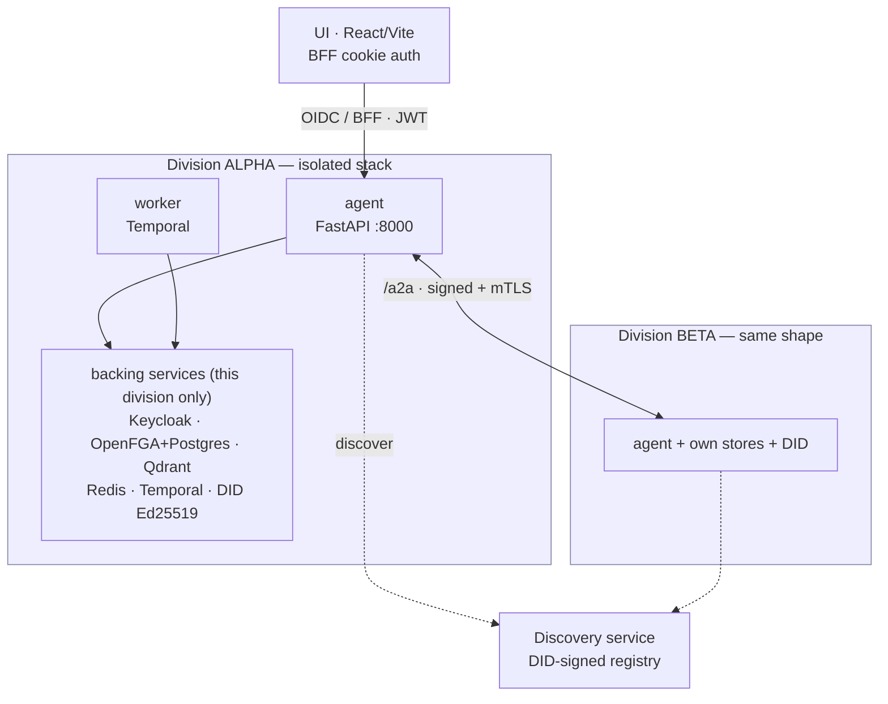
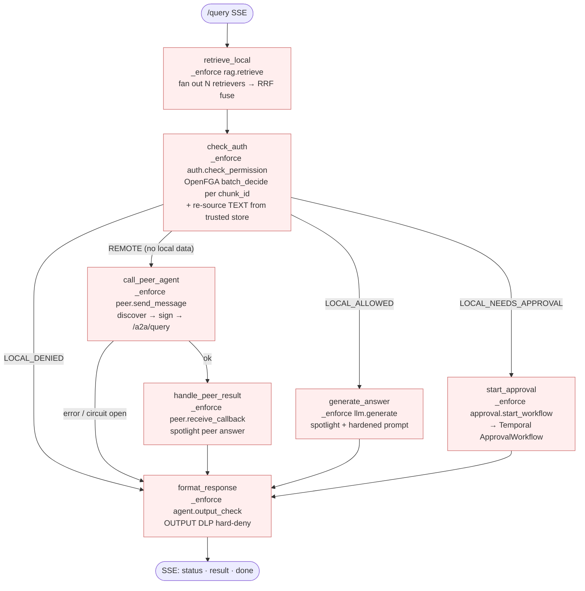
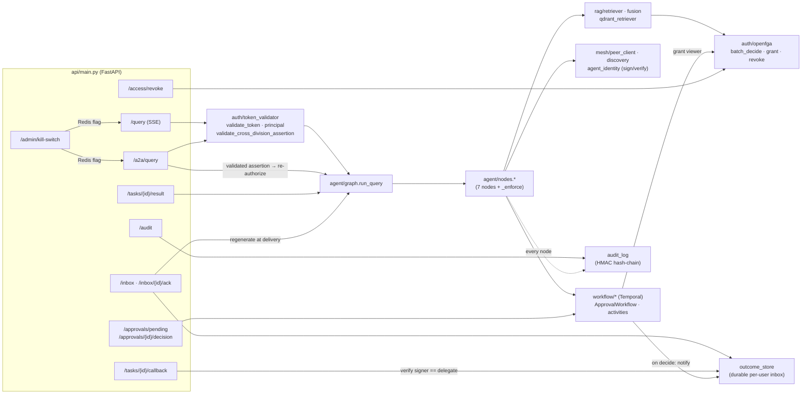
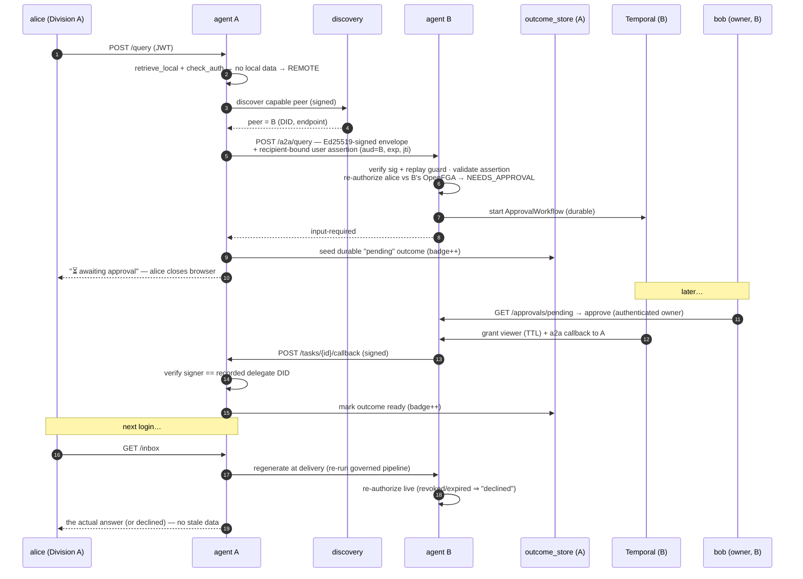
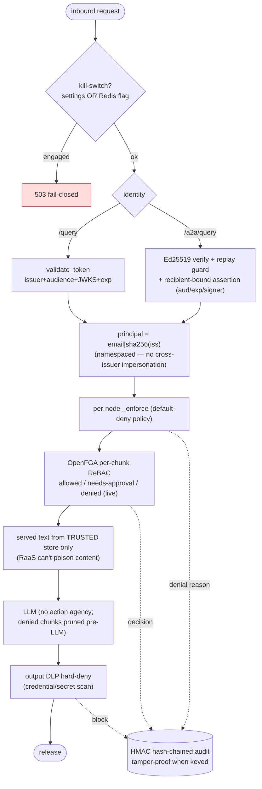
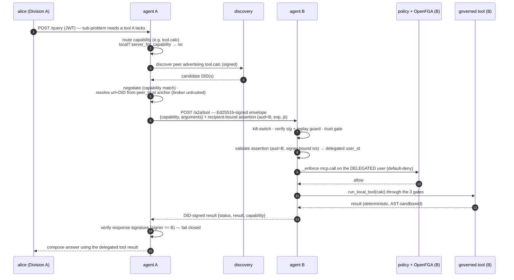

# Architecture — AGT Federated RAG

How the system is wired: components, the request **dataflow**, the **callgraph**, the
cross-division **federation + offline-delivery** sequence, and where each **security control**
sits on the path. Diagrams are Mermaid (render on GitHub / most Markdown viewers).

> Companion docs: `README.md` (what + setup), `PROJECT_STATUS.md` (what's built),
> `THREAT_MODEL.md` (security posture), `k8s/README.md` (Kubernetes), `docs/archive/` (history).
> This file is the **structure**; those are scope, status, and security.

---

## 1. Component / deployment view

Each **division** is a physically-isolated stack (own IdP realm, ReBAC store, vector DB,
workflow engine, secrets, and Ed25519 DID). Nothing shared crosses a division boundary (NFR-2);
cross-division traffic is **only** the DID-signed `/a2a/*` path.

**Isolation mechanics:** on Kubernetes each division is its own Namespace with a default-deny
`NetworkPolicy` (only the agent pod, only `/a2a` on :8000, is reachable cross-namespace). On
Compose each division is its own project/network. The discovery service never holds division
data — its loss degrades discovery, never authorization.

---

## 2. Request dataflow — the governed LangGraph pipeline

Every `/query` runs the **same 7-node graph** (`agent/graph.py`). Each node calls `_enforce()`
(default-deny policy) **before** doing work. Authorization is decided per-chunk **after**
retrieval and **before** generation, so denied data never reaches the LLM.

**The three-way authorization outcome** (`check_auth` → OpenFGA `batch_decide`): every retrieved
`chunk_id` resolves to **allowed** / **needs-approval** / **denied**. Flow priority:
`pending > allowed > remote(only if no local data) > denied`. A RaaS/external retriever can
contribute candidate ids + ranking, but the served **text** is re-sourced from the trusted
store of record — so an external backend can never widen access *or* poison content.

---

## 3. Callgraph — endpoint → graph → services

The HTTP surface (`api/main.py`) and which collaborators each path touches. `/query` and
`/a2a/query` share the **same** `run_query` graph; the difference is identity handling at the door.

---

## 4. Cross-division federation + offline delivery (sequence)

The headline path: alice@A asks for B's data she's not yet cleared for; she goes offline;
bob@B approves later; the answer reaches her account on next login — regenerated under a fresh
authorization check (no stale leak).

---

## 5. Security-control dataflow (where each gate sits)

Same path, annotated with the control at each hop. Every gate **fails closed**.

**Transport (not shown above):** internet-facing `/a2a/*` uses mutual TLS with **CRL revocation
checked at the handshake** and optional **OCSP** (`TLS_OCSP_MODE=soft|hard`, decided off the event
loop before any request byte is parsed). Browser auth uses the **BFF**
pattern — no token in the browser, only an `HttpOnly` cookie.

---

## 6. Cross-agent tool delegation (governed)

When an agent hits a sub-problem needing a **tool capability it lacks** (e.g. arithmetic via
`tool.calc`, unit conversion via `tool.units`), it doesn't fail — it discovers the peer that
**advertises** that capability and delegates the *tool call* over a DID-signed `/a2a/tool`
channel. The peer runs **its own** governed tool and returns a signed result. This is the same
security envelope as `/a2a/query` (kill-switch → Ed25519 verify + replay guard → trust gate →
recipient-bound assertion → policy → governed execution → signed reply), applied to a tool call
instead of a query.

`solve_with_tools` (`agent/nodes.py`) is the orchestrator: it routes the sub-problem to a
capability, runs it **locally first** when this division serves it (`run_local_tool` through the
three MCP gates), and only delegates when it doesn't. The local tools are **deterministic and
sandboxed** — `calc` evaluates an **AST allowlist** (no `eval`; names/attribute-access/calls
outside a fixed grammar are rejected), `units` is a fixed table. The delegation loop is **bounded**
(`max_tool_delegations`) so a capability gap can't trigger a runaway peer-call chain.

Two invariants carry over from federation unchanged: **no raw user token is ever forwarded** (the
delegated identity travels as a recipient-bound, short-TTL *assertion* — `aud` = the peer's DID —
minted from the per-request claims ContextVar, never a bearer token); and the peer **re-runs its
own default-deny policy on the delegated user** before executing, so delegation never bypasses the
peer's authorization. A tool/policy failure returns a **signed `status="failed"`**, never a 500.

---

## 7. Where it lives (code map)

| Concern | Module(s) |
|---|---|
| HTTP surface, SSE, kill-switch, /audit, /inbox | `api/main.py` |
| Governed graph + routing | `agent/graph.py`, `agent/nodes.py`, `agent/policies/*.yaml` |
| Retrieval (pluggable, multi + RaaS) | `rag/retriever.py`, `rag/fusion.py`, `rag/qdrant_retriever.py` |
| Per-chunk authorization (ReBAC) | `auth/openfga.py` |
| Identity (token + cross-division assertion) | `auth/token_validator.py` |
| Federation (sign/verify, discover, delegate) | `mesh/agent_identity.py`, `mesh/peer_client.py` (`call_peer_agent`, `call_peer_tool`), `mesh/discovery.py` (`find_peer_for_capability`), `discovery/` |
| Governed tools + cross-agent delegation | `tools/mcp.py`, `tools/local_tools.py` (AST-sandboxed `calc`, `units`), `agent/nodes.py` `solve_with_tools`, `api/main.py` `/a2a/tool` |
| Approvals + offline delivery | `workflow/`, `outcome_store.py` |
| Transport / mTLS / CRL | `transport/mtls.py`, `scripts/issue_division_certs.py` |
| Tamper-proof audit | `audit_log.py` |
| Deployment | `infra/` (Compose IaC), `k8s/` (kustomize) |

Each box above has tests under `agt-federated-rag/tests/` (344 collected); see
`PROJECT_STATUS.md` for the requirement→test mapping.
